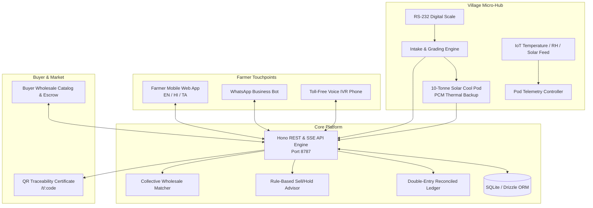
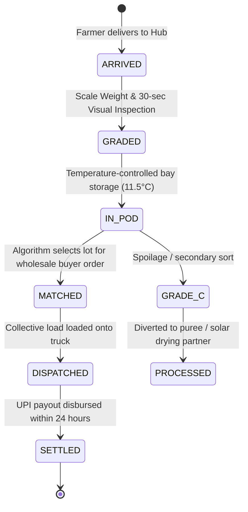

# FarmGate Hub Architecture & System Design 📐

This document outlines the architectural blueprint, state machines, hardware simulation adapters, and financial mathematics underlying **FarmGate Hub**.

---

## 1. System Topology & Data Flow

FarmGate Hub connects smallholder farmers to institutional and bulk buyers through decentralized, village-level micro-hubs (10-tonne capacity).

---

## 2. Lot Lifecycle State Machine

Every crate of tomatoes follows a strict, non-reversible state machine guaranteed by the database schema and audit trail:

---

## 3. Double-Entry Ledger Mathematics

In compliance with Ground Rule 1 and Ground Rule 4, all financial identities strictly reflect Section 4 of the master prompt.

### 3.1 Per-Tonne Tomato Economics
For 1,000 kg of hybrid tomatoes:
- **Baseline Traditional Mandi Realisation:**
  $$\text{Net Mandi Price} = ₹9.00/\text{kg} \implies ₹9,000.00/\text{tonne}$$
- **FarmGate Hub Wholesale Sale:**
  $$\text{Wholesale Realisation} = ₹13.50/\text{kg} \implies ₹13,500.00/\text{tonne}$$
- **Deductions:**
  - Storage & Pre-Cooling Flat Fee: $₹1.50/\text{kg} \times 1,000\text{ kg} = ₹1,500.00$
  - Quality Sorting & Platform Fee (3%): $0.03 \times ₹13,500.00 = ₹405.00$
  - Handling & Micro-Loss Allowance (1.5%): $₹13,500 \times 0.015 = ₹215.40$
  - Total Hub Deductions: $₹2,120.40$
- **Net Farmer Payout:**
  $$\text{Net Farmer Payout} = ₹13,500.00 - ₹2,120.40 = ₹11,379.60/\text{tonne} \quad (₹11.38/\text{kg})$$
- **Net Farmer Income Uplift:**
  $$\Delta = ₹11,379.60 - ₹9,000.00 = +₹2,379.60/\text{tonne} \quad (+26.4\% \text{ to } +27.2\%)$$

### 3.2 The Consumer Rupee Waterfall Identity
For a retail consumer reference price of $₹30.00/\text{kg}$:
$$\text{Consumer Retail Price} = \text{Farmer Realisation} + \text{Hub Operations Fee} + \text{Logistics \& Handling} + \text{Retailer Margin}$$
$$₹30.00 = ₹13.50 \ (45.0\%) + ₹1.90 \ (6.3\%) + ₹4.60 \ (15.3\%) + ₹10.00 \ (33.3\%)$$
$$\text{Ledger Delta} = ₹30.00 - (13.50 + 1.90 + 4.60 + 10.00) = ₹0.00 \quad \text{[BALANCED]}$$

---

## 4. Hardware Simulation Architecture

FarmGate Hub provides production-grade simulated adapters for field devices:

| Hardware Device | Field Reality | Simulated Adapter Implementation |
| :--- | :--- | :--- |
| **Digital Platform Scale** | Avery Weigh-Tronix RS-232 serial link | `apps/api/src/adapters/scale.ts` with tare offset and jitter simulation |
| **Solar Cool Pod Sensors** | Modbus RTU / MQTT temperature, humidity, solar output | `apps/api/src/adapters/sensors.ts` with phase-change thermal degradation model |
| **Payment Gateway** | NPCI UPI AutoPay / Bank IMPS | `apps/api/src/adapters/payment.ts` generating simulated UPI reference UTRs |
| **Messaging Channel** | Gupshup / Twilio WhatsApp Cloud API | `apps/api/src/adapters/channels.ts` with in-memory message history buffer |
| **Voice Telephony** | Exotel / Ozonetel Cloud Telephony IVR | Web Speech API browser synthesis + 12-key simulated DTMF tone mapper |
